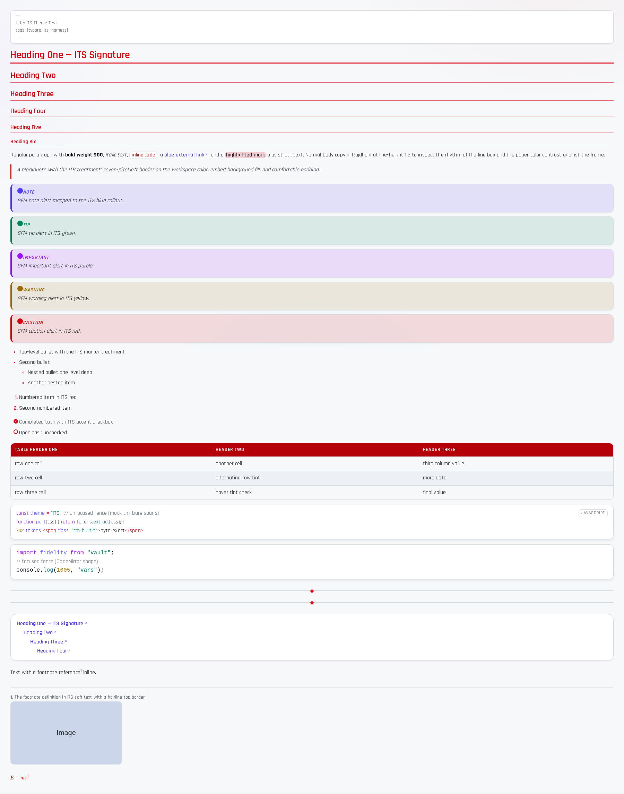
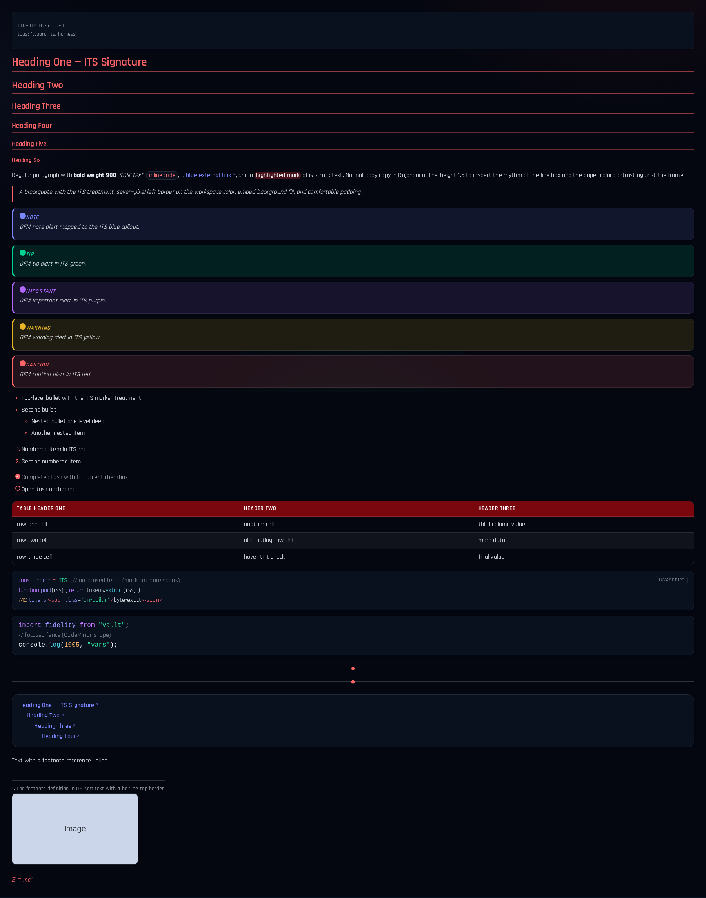

# CryptoMize Typora Theme

The CryptoMize brand for [Typora](https://typora.io) — a vivid red-on-ink markdown theme in two modes: **CryptoMize** (light) and **CryptoMize Dark**. Rajdhani typography, rounded soft-shadow surfaces, full-width flow, WCAG AA contrast throughout, and a print design that exports clean A4 PDFs.





## Install

1. Download or clone this repository.
2. Copy **everything inside `dist/`** into Typora's theme folder:
   - **Windows:** `File → Preferences → Appearance → Open Theme Folder` (typically `%APPDATA%\Typora\themes\`)
   - **macOS:** `~/Library/Application Support/abnerworks.Typora/themes/`
   - **Linux:** `~/.config/Typora/themes/` — **Typora Flatpak:** `~/.var/app/io.typora.Typora/config/Typora/themes/`
3. **Fully restart Typora.**
4. Pick **CryptoMize** or **CryptoMize Dark** from the `Themes` menu.

You should end up with `themes/cryptomize.css`, `themes/cryptomize-dark.css`, `themes/cryptomize.meta.json`, `themes/cryptomize-dark.meta.json`, and `themes/cryptomize-assets/` (four Rajdhani weights + license).

## Features

- **Brand system** — palette, radius scale, layered shadows, easing curves, scrollbar, focus rings, and typography laws all derive from the CryptoMize design system (`BRAND-SYSTEM.md` documents every mapping).
- **Rajdhani everywhere** — text, headings, UI, and code (Latin + Devanagari). Bundled weights 400/500/600/700 (SIL OFL).
- **Full-width flow** — the writing surface uses your whole window. Prefer a capped measure? Set `--file-line-width: 900px` in a `cryptomize.user.css` (see below).
- **WCAG AA everywhere** — every foreground/background pair the theme paints is audited (`scripts/wcag-audit.py`, 34 pairs × 2 modes).
- **Syntax highlighting** — fenced code, unfocused code, and source mode all covered, with an uppercase language chip on fenced blocks.
- **GFM alerts** — `> [!note] / [!tip] / [!important] / [!warning] / [!caution]` in the brand semantic palette.
- **Print/PDF** — A4 with real margins, pt typography, no orphaned headings, no split code/alerts/table rows; table headers repeat across pages. The dark theme flips to light for ink-friendly export (delete the `[PRINT-FLIP]` block at the end of `cryptomize-dark.css` to keep dark export).
- **App chrome** — sidebar, outline, footer, menus, megamenu, modals, tooltips, search panel, and scrollbars all themed.

## Knobs (per-theme overrides)

Create `cryptomize.user.css` / `cryptomize-dark.user.css` next to the theme files; Typora loads them automatically.

```css
:root {
  --file-line-width: 900px;  /* none (default) = full width */
  /* anything else from the token block at the top of the theme file */
}
```

## Build from source

```
python3 scripts/gen-tokens.py   # regenerate brand token files
python3 build.py                # assemble dist/ + integrity checks
```

Verification tooling: `scripts/harness.py v1` (Chromium parse), `v5` (screenshots), `scripts/wcag-audit.py` (contrast), `scripts/pdf-check.py` (print/PDF), `scripts/v2-coverage.py` (selector contract).

## License

MIT (see `LICENSE`). Bundled Rajdhani fonts are licensed separately under the SIL Open Font License 1.1 (`dist/cryptomize-assets/Rajdhani-OFL.txt`).
